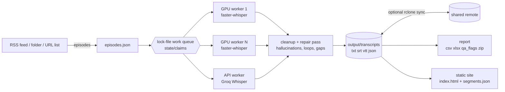
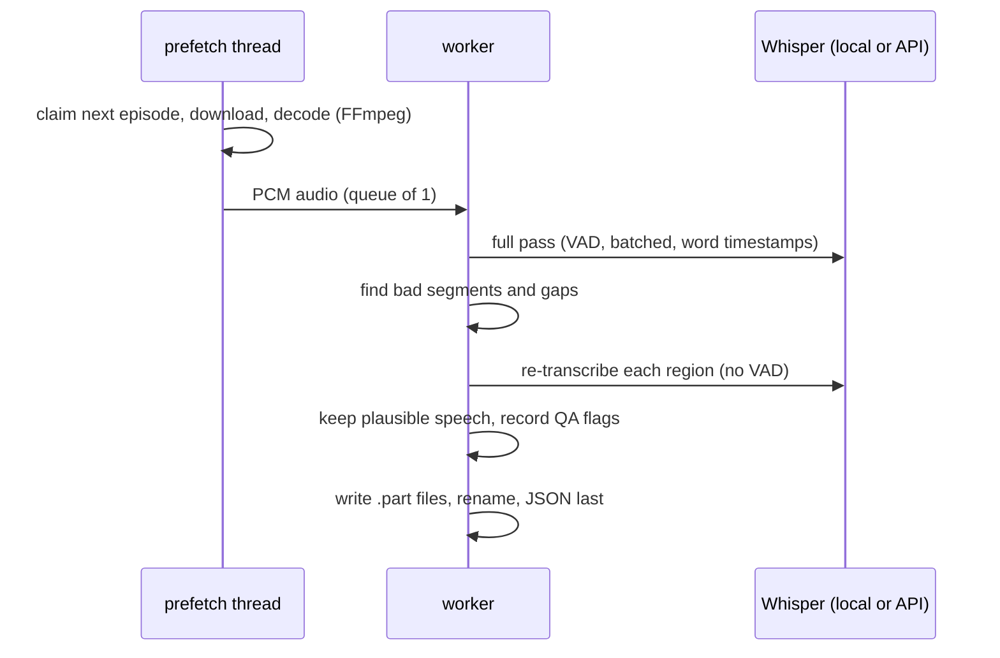

# transcription-pipeline

Turns a podcast or audio archive into searchable transcripts. Give it an RSS feed, a folder of audio files
or a list of URLs; it produces timestamped TXT, SRT and WebVTT subtitles, JSON with word-level timings,
a QA report of suspicious passages and a static website with full-text search that plays the audio from
any hit.

It is built for archives of hundreds of long episodes rather than single files: work is split across
any number of GPU workers or API processes, every finished episode is written immediately, and an
interrupted run continues where it stopped.

## Real-world use

Used to transcribe a ~380-episode podcast archive (about 350 hours of audio) for a client in the US.
The run combined free Kaggle and Colab GPUs with Groq API workers on a laptop, all sharing one episode
list. Measured throughput: faster-whisper large-v3 on a T4 GPU at ~19x real time per worker (including
the repair pass), Groq whisper-large-v3 at ~47x real time per process.

## Features

- **Inputs:** podcast RSS feed (enclosures, dates, titles, descriptions), a local folder of audio files,
  or a text file of URLs. Anything FFmpeg can decode works.
- **Two backends with the same output format:**
  - local [faster-whisper](https://github.com/SYSTRAN/faster-whisper) (CTranslate2), batched inference
    with VAD and word timestamps, on GPU or CPU;
  - [Groq](https://console.groq.com/docs/speech-to-text) Whisper API (large-v3 or large-v3-turbo); audio
    is re-encoded to mono 16 kHz 32 kb/s to fit the upload limit, rate limits (HTTP 429) are waited out
    using the server's `retry-after`.
- **Parallel workers without a coordinator:** each worker claims an episode by atomically creating a lock
  file (`O_CREAT | O_EXCL`), so several processes per GPU, several GPUs and API workers can share one list.
  A multi-GPU launcher starts N workers per card, staggers model loading and prints progress and ETA.
- **Resumable:** outputs are written to `.part` files and renamed when complete; the JSON is the "done"
  marker. Restarting skips finished episodes. The next episode is downloaded and decoded in a background
  thread while the GPU works on the current one.
- **Multi-machine runs:** deterministic sharding (`--shards 0,1 --shard-count 3`): each machine does its
  own shards first, then helps with the remaining episodes from the other end of the list. An optional
  rclone sync pushes results to a shared remote and pulls the list of episodes finished elsewhere.
  A deadline option stops taking new work before a time-limited session (Kaggle, Colab) is killed.
- **Repair pass for Whisper's failure modes on long recordings:**
  - removes invented sentences on music/silence ("Thanks for watching", "Subtitles by ..."), repetition
    loops, low-diversity garbage and "prompt leaks" (the model reading back the vocabulary prompt);
  - re-transcribes removed segments and suspicious silences (> 6 s inside the recording, > 20 s at the
    edges) without VAD, and keeps the result only if it looks like real speech (word-rate check);
  - records every action plus low-confidence passages and over-long words as QA flags with timestamps.
- **Domain vocabulary and spelling fixes** from config (initial prompt, regex replacements).
- **Outputs per episode:** `.txt` (paragraphs with `[hh:mm:ss]` markers), `.srt`, `.vtt`, `.json`
  (segments, word timings with probabilities, QA flags, engine and timing metadata).
- **Archive reports:** `episodes.csv` / `.xlsx`, `qa_flags.csv` for human review, `transcripts.zip`.
- **Static archive site:** a single `index.html` plus `segments.json`, no server needed. Searches titles,
  summaries, keywords and every transcript line, highlights hits, and seeks the built-in audio player to
  the exact second. Keywords are extracted with TF-IDF across the archive; optional per-episode metadata
  files can add summaries, people and key moments (in the original project these were written in a
  separate LLM pass, which is not part of this repository).
- **Kaggle/Colab notebook** that installs the package, builds the episode list and runs the launcher.

## Architecture



Per episode, inside a worker:



| Module | Responsibility |
| --- | --- |
| `episodes.py` | RSS / folder / URL list parsing, stable ids, date filters, shard ordering |
| `audio.py` | FFmpeg decoding, compression and clipping, resilient downloads |
| `jobs.py` | lock-file claims, done detection, skip file, JSONL run log |
| `cleanup.py` | hallucination, loop, low-diversity and prompt-leak detection; text fixes |
| `repair.py` | region detection and the second pass, shared by both backends |
| `local_backend.py` | faster-whisper worker with prefetching |
| `groq_backend.py` | Groq API client, response conversion, worker |
| `launcher.py` | N workers per GPU, deadline, progress/ETA, optional sync |
| `formats.py` | TXT / SRT / VTT / JSON writers, atomic save |
| `report.py`, `site.py`, `keywords.py` | archive summary, static search site, TF-IDF keywords |

## Quick start

Requirements: Python 3.10+, FFmpeg on `PATH`, and for the local backend an NVIDIA GPU with CUDA 12
(CPU also works, slower).

```bash
git clone https://github.com/LektorGW/transcription-pipeline
cd transcription-pipeline
pip install -r requirements.txt

# 1. episode list (RSS feed, folder of files, or URL list)
python -m transcription_pipeline episodes --rss https://example.com/feed.xml --since 2025-01-01 -o episodes.json
python -m transcription_pipeline episodes --dir ./recordings -o episodes.json

# 2a. local GPU
python -m transcription_pipeline local --episodes episodes.json
# 2b. all GPUs, 2 workers per card, stop taking new episodes after 11 h
python -m transcription_pipeline launch --episodes episodes.json --workers-per-gpu 2 --max-hours 11
# 2c. no GPU: CPU with a smaller model, or the Groq API (GROQ_API_KEY in .env)
python -m transcription_pipeline local --episodes episodes.json --model small --device cpu --compute-type int8
python -m transcription_pipeline groq --episodes episodes.json

# 3. reports and the searchable site
python -m transcription_pipeline report
python -m transcription_pipeline site -o site      # open site/index.html via any static web server
```

Workers can be combined freely: start `launch` on a GPU machine and `groq` on a laptop against the same
output and state directories (or the same rclone remote) and they will split the work.

Crashed worker left a lock behind? `python -m transcription_pipeline reset-claims` (only while nothing is running).

For free GPUs, open `notebooks/gpu_run_kaggle_colab.ipynb` on Kaggle (GPU T4 x2) or Colab (T4), set
`FEED_URL` and run all cells.

## Configuration

All settings have defaults; override them in a YAML or JSON file passed with `--config` (see
[`config.example.yaml`](config.example.yaml)). Secrets come only from the environment or a local `.env`
file (see [`.env.example`](.env.example)), never from the config.

| Key | Purpose |
| --- | --- |
| `vocabulary` | names and terms passed to Whisper as the initial prompt |
| `replacements` | regex fixes for recurring misspellings |
| `extra_hallucinations` | show-specific phrases to drop (e.g. a recurring outro) |
| `repair.*` | gap thresholds, edge handling, enable/disable the second pass |
| `local.*` | model, device, compute type, batch size, beam size, VAD |
| `groq.*` | model (`whisper-large-v3` / `-turbo`), upload bitrate |
| `sync.remote` | rclone remote shared by several machines |
| `site.*` | title, subtitle, footer, optional metadata folder |

Output layout:

```
output/
  transcripts/<id>.txt .srt .vtt .json
  run_log*.jsonl          one line per event and worker
  episodes.csv/.xlsx      after `report`
  qa_flags.csv            timestamps worth a human look
  transcripts.zip
state/
  claims/<id>.lock        who is working on what
  failed/<id>.txt         traceback per failed episode
```

## Tests

```bash
pip install -r requirements-dev.txt
pytest
```

The suite runs without network access or model downloads: timestamp and subtitle formatting, atomic
saving, hallucination/loop/prompt-leak detection, gap detection and the repair pass (with a fake
transcriber), lock-file claims and resume logic, RSS parsing and sharding, TF-IDF keywords, and an
end-to-end Groq run against a fake HTTP session on an FFmpeg-generated tone that ends in the report and
the static site.

## Tech stack

Python, faster-whisper (CTranslate2) and Whisper large-v3, Groq API, FFmpeg, NumPy, requests, rclone
(optional), vanilla HTML/CSS/JavaScript for the site, pytest. Ran on Kaggle and Google Colab GPUs
(NVIDIA T4) and on Windows/Linux workstations.

## Author

Maciej Kaczmarczyk, [mkaczmarczyk.com](https://mkaczmarczyk.com)

## License

All rights reserved, shared as a portfolio project.
